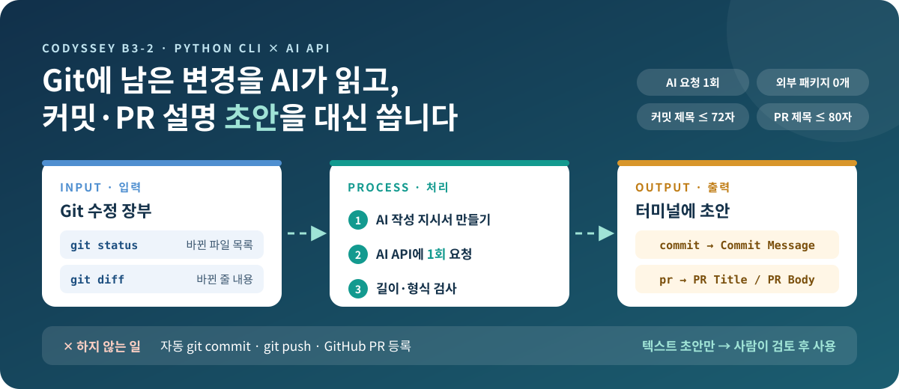
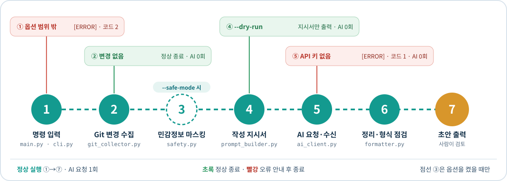
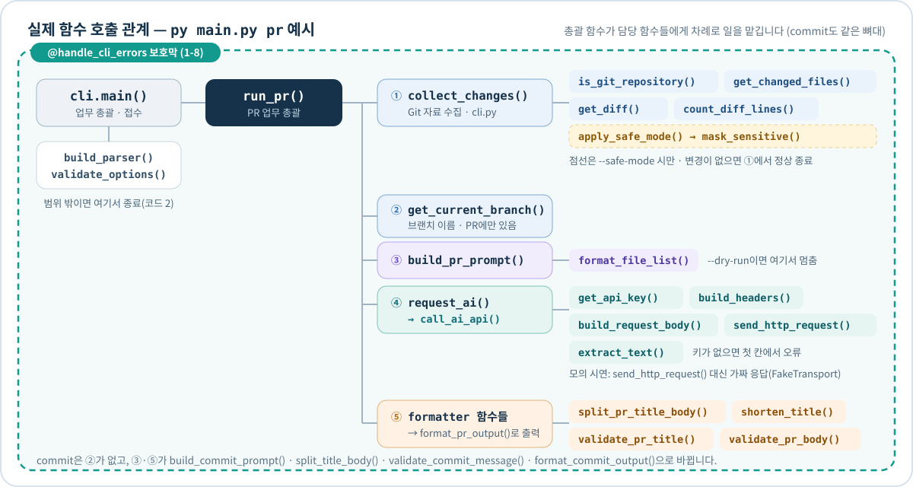
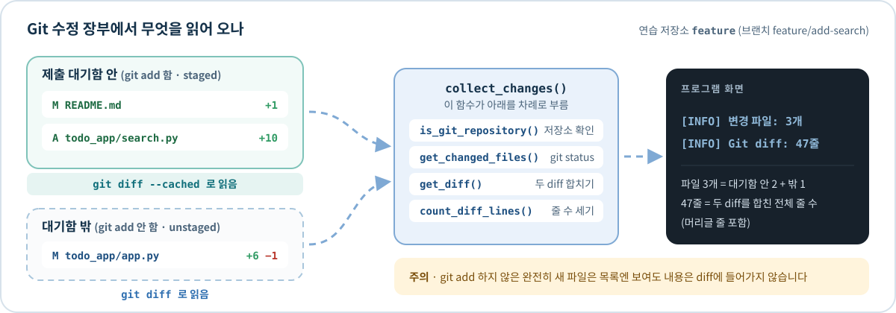
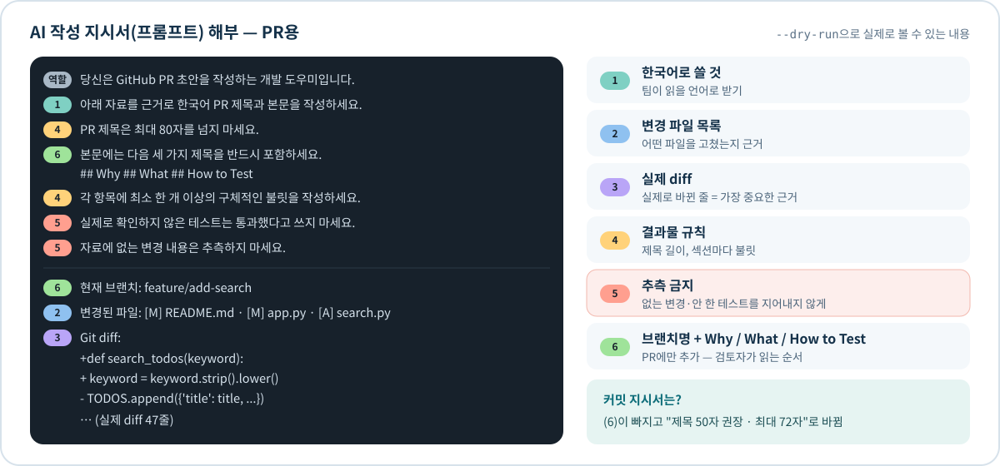
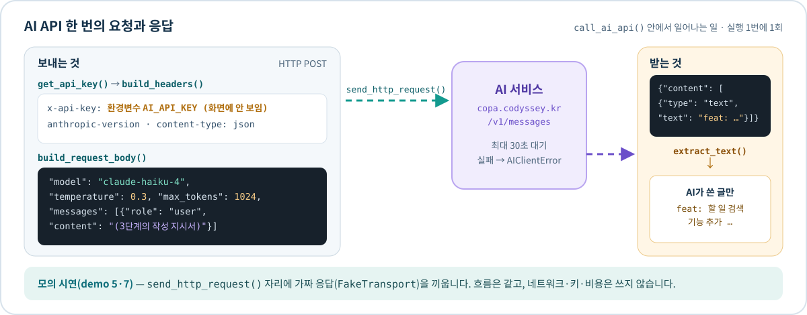
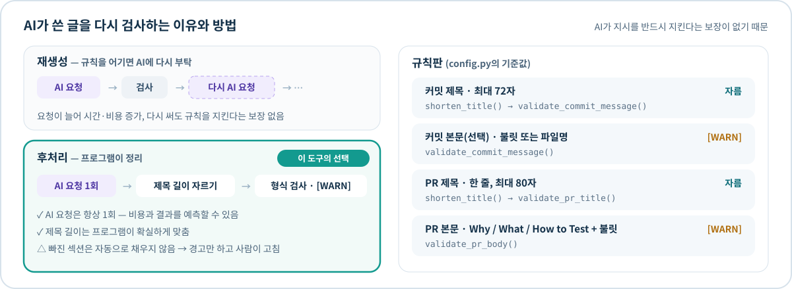
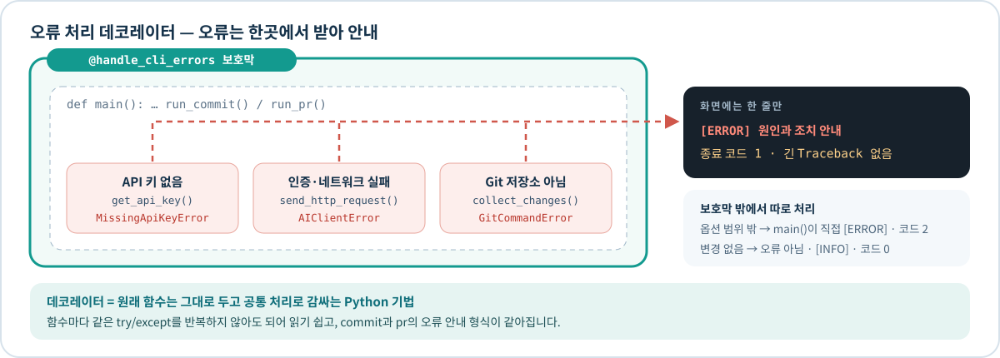
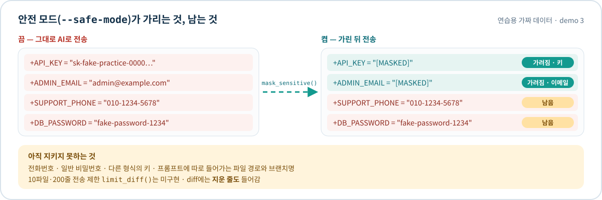
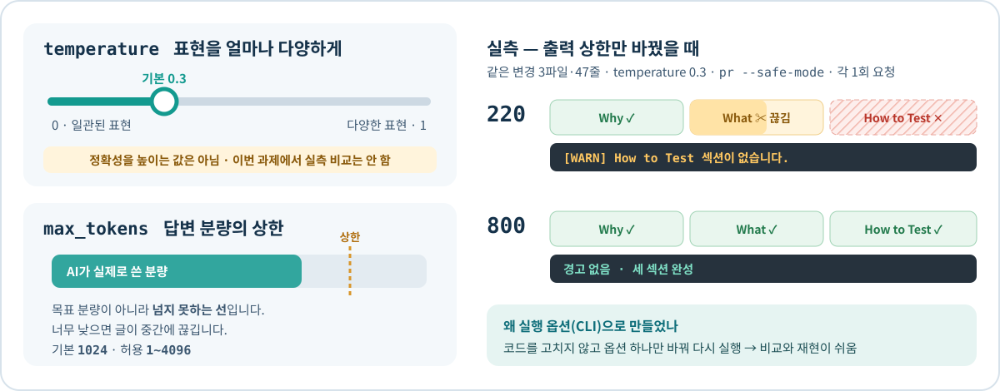

# B3-2 | Git 변경사항을 AI로 설명하는 커밋·PR 초안 생성기

<p align="center"></p>

<small>[그림 크게 보기](docs/readme/00-overview.svg)</small>

코디세이 B3-2 「내가 고친 코드 설명을 AI가 대신 써주는 도우미 만들기」의 Python CLI 프로그램입니다.

**기준 환경:** Python 3.10 이상 · Windows PowerShell · 외부 패키지 없음 · [소스 코드 (`feature/my-b3-2`)](https://github.com/beatles12/codyssey-b3-2-ai-git/tree/feature/my-b3-2)

## 이 문서의 진행 방식

프로그램이 일하는 순서대로 **7단계**로 나눴습니다. 단계마다 **그림으로 이해 → 담당 함수 확인 → 직접 실행 → 결과 해석 → 다음 단계**로 이어집니다.

| 단계 | 배우는 것 | 직접 보여주는 것 |
|:-:|---|---|
| [1](#step1) | 프로그램 소개와 전체 흐름 | 실행 위치·도움말 확인 |
| [2](#step2) | Git 변경사항 수집 | `git status` · `git diff` → 파일 3개·47줄 |
| [3](#step3) | AI 작성 지시서(프롬프트) | `--dry-run`으로 커밋·PR 지시서 비교 |
| [4](#step4) | AI API 요청과 초안 생성 | 모의 AI 요청 구조 → 실제 AI 초안 |
| [5](#step5) | 출력 검증과 후처리 | 긴 제목 자르기·빠진 섹션 경고 |
| [6](#step6) | 오류 처리와 보안 | 키 누락·변경 없음·마스킹·잘못된 옵션 |
| [7](#step7) | AI 설정과 개선 방향 | `max_tokens` 220 vs 800 실측 |
| [부록](#appendix) | 자동 테스트 · 설치 · API 키 · 함수 사전 | |

**명령 상자의 표시**

| 표시 | 뜻 |
|---|---|
| 📌 **단독 실행** | 이 상자만 복사해도 됩니다. 연습 저장소를 쓰는 상자는 이미 있는 `practice_repo`를 사용합니다. **프로젝트 폴더에서 시작**하며 연습 저장소를 자동 생성하거나 지우지 않습니다. |
| 🟢 **모의 AI** | 실제 AI 대신 시험용 응답을 씁니다. API 키 불필요, 비용 없음. |
| 🔍 **미리보기** | `--dry-run` — AI를 부르지 않고 보낼 지시서만 보여줍니다. 비용 없음. |
| 🟠 **실제 AI** | 네이토 API를 호출합니다. [API 키 등록](#api-key)이 먼저 필요하고 토큰이 사용됩니다. |

결과 상자에는 **📄 실제 실행 기록**(실제로 실행해서 나온 화면)과 **🧪 모의 AI 결과 예시**(시험용 응답의 화면)를 구분해 적었습니다. 연습 명령은 `main.py`가 있는 **프로젝트 폴더**에서 시작합니다. `Push-Location`은 기존 연습 폴더로 이동하고, `Pop-Location`은 원래 프로젝트 폴더로 돌아옵니다.

---

<a id="step1"></a>

## 1단계 · 프로그램 소개 — 명령 한 줄이 지나가는 길

Git은 파일의 변경 내역을 남기는 **수정 장부**입니다. **커밋 메시지**는 이번에 한 일을 적는 ‘업무 기록 제목’이고, <b>PR(Pull Request)</b>은 동료에게 변경 내용을 설명하고 검토를 부탁하는 ‘검토 요청서’입니다. 바뀐 파일이 많아질수록 직접 정리하는 데 시간이 들기 때문에, Git에 남은 변경 내용을 AI가 읽고 **초안**을 쓰도록 만들었습니다.

<p align="center"></p>

<small>[그림 크게 보기](docs/readme/11-flow.svg)</small>

> [!IMPORTANT]
> **정상 실행에서 AI는 딱 1회만 부릅니다.** 변경이 없거나(②) `--dry-run`이면(④) AI 없이 끝나고, API 키가 없으면 AI에 보내기 직전(⑤)에 오류로 안내합니다. 결과는 **텍스트 초안**일 뿐이며, 실제 커밋·`git push`·PR 등록은 하지 않습니다.

### 파일마다 맡은 일

| 담당 파일 | 쉽게 이해하는 역할 | 맡은 일 |
|---|---|---|
| [`main.py`](https://github.com/beatles12/codyssey-b3-2-ai-git/blob/feature/my-b3-2/main.py#L23) | **접수 창구** | 프로그램 시작, 최종 종료 코드 전달 |
| [`cli.py`](https://github.com/beatles12/codyssey-b3-2-ai-git/blob/feature/my-b3-2/ai_gitgen/cli.py#L196) | **업무 총괄** | 명령·옵션 확인, 담당 함수들을 순서대로 호출 |
| [`git_collector.py`](https://github.com/beatles12/codyssey-b3-2-ai-git/blob/feature/my-b3-2/ai_gitgen/git_collector.py#L60) | **변경 장부 담당** | Git 저장소 확인, 변경 파일 목록과 diff 수집 |
| [`safety.py`](https://github.com/beatles12/codyssey-b3-2-ai-git/blob/feature/my-b3-2/ai_gitgen/safety.py#L32) | **일부 개인정보 가리기** | `--safe-mode`일 때 diff의 일부 민감정보 마스킹 |
| [`prompt_builder.py`](https://github.com/beatles12/codyssey-b3-2-ai-git/blob/feature/my-b3-2/ai_gitgen/prompt_builder.py#L18) | **AI 업무 지시서 작성** | 커밋/PR 규칙과 변경 자료를 하나의 프롬프트로 묶기 |
| [`ai_client.py`](https://github.com/beatles12/codyssey-b3-2-ai-git/blob/feature/my-b3-2/ai_gitgen/ai_client.py#L151) | **AI 송수신 담당** | 키 확인, 요청 구성·전송, 응답에서 글 꺼내기 |
| [`formatter.py`](https://github.com/beatles12/codyssey-b3-2-ai-git/blob/feature/my-b3-2/ai_gitgen/formatter.py#L11) | **교정·검수 담당** | 제목·본문 분리, 길이 보정, 섹션·불릿 검사, 출력 |
| [`config.py`](https://github.com/beatles12/codyssey-b3-2-ai-git/blob/feature/my-b3-2/ai_gitgen/config.py#L3) | **공통 규정표** | 모델·옵션 기본값, 제목 글자 수, 필수 섹션 |

### 실제 함수 호출 관계

`run_pr()`이 담당 함수들을 **차례로 부르는** 구조입니다. 예를 들어 `collect_changes()` 안의 네 함수는 서로를 부르지 않고, `collect_changes()`가 하나씩 부릅니다.

<p align="center"></p>

<small>[그림 크게 보기](docs/readme/12-calltree.svg)</small>

<details>
<summary><strong>같은 내용을 글자로 보기</strong></summary>

```text
main.py: run()
└─ cli.main()                       [@handle_cli_errors 로 감쌈]
   ├─ build_parser() / validate_options()
   └─ run_commit() 또는 run_pr()     [업무 총괄]
      ├─ collect_changes()
      │  ├─ is_git_repository()
      │  ├─ get_changed_files() → parse_status_output()
      │  ├─ get_diff()              [git diff --cached + git diff]
      │  ├─ count_diff_lines()
      │  └─ (--safe-mode) apply_safe_mode() → mask_sensitive()
      ├─ (pr만) get_current_branch()
      ├─ build_commit_prompt() 또는 build_pr_prompt() → format_file_list()
      ├─ (--dry-run) 지시서만 출력하고 종료 · AI 요청 0회
      ├─ request_ai() → call_ai_api()
      │  ├─ get_api_key()
      │  ├─ build_headers() / build_request_body()
      │  ├─ send_http_request()
      │  └─ extract_text()
      └─ formatter: split → shorten_title → validate → format 출력
```

</details>

**초안 검토 원칙:** 제목 길이와 PR 섹션처럼 기계가 검사할 수 있는 형식은 프로그램이 점검합니다. 그러나 변경 이유와 실제 테스트의 참·거짓은 Git diff와 실행 결과를 보고 사람이 판단해야 합니다.

**설계 이유:** Git 자료 수집과 AI 통신을 나누면 네트워크 없이 Git만 검사하거나, 실제 AI 대신 가짜 응답을 연결해 시험할 수 있습니다. 지시서 작성과 결과 검사를 나누면 AI에 부탁한 내용과 실제로 받은 결과를 각각 확인할 수 있습니다.

### ▶ 직접 확인 — 실행 위치와 명령 목록

📌 단독 실행

```powershell
Get-Location
Test-Path .\main.py
git branch --show-current
py main.py --help
```

🔎 **화면에서 찾아볼 것:** `True` · `feature/my-b3-2` · `{commit,pr}`. 연습용 `practice_repo`는 별도의 Git 저장소입니다.

**정상 결과:** `Test-Path`가 `True`, 브랜치가 `feature/my-b3-2`, 도움말에 `commit`과 `pr`이 보입니다. `False`라면 터미널의 현재 폴더가 프로젝트 폴더가 아닙니다. (Python을 `python` 명령으로 쓰는 환경이라면 `python main.py commit`, `python main.py pr`로 실행합니다.)

**연습 저장소 사전 확인:** 왼쪽 탐색기에서 `practice_repo`가 있는지 보고, PowerShell에서 아래 한 번만 확인합니다. **생성·초기화 명령은 실행하지 않습니다.**

```powershell
Test-Path .\practice_repo\.git
git -C .\practice_repo branch --show-current
git -C .\practice_repo status --short
```

정상 예시는 `True` · `feature/add-search` · 변경 파일 3개입니다. **결과가 다르다면 그대로 유지하고** 시연용 파일 상태를 먼저 확인합니다. 연습 저장소를 덮어쓰거나 지우지 않습니다.

**다음 단계:** 흐름의 첫 재료인 **Git 변경사항**을 실제로 읽어 봅니다.

---

<a id="step2"></a>

## 2단계 · Git 변경사항 수집 — AI가 읽을 재료

<p align="center"></p>

<small>[그림 크게 보기](docs/readme/20-git.svg)</small>

> [!TIP]
> **프로그램은 Git 명령 세 가지로 재료를 모읍니다.** `git status`로 바뀐 파일 목록을, `git diff --cached`로 제출 대기함에 넣은 변경을, `git diff`로 아직 넣지 않은 변경을 가져와 합칩니다.

| Git 명령 | 업무 비유 | 담당 함수 |
|---|---|---|
| `git status --porcelain` | 바뀐 문서 목록 | `get_changed_files()` → `parse_status_output()` |
| `git diff --cached` | 제출 대기함에 넣은 수정 내역 (staged) | `get_diff()` |
| `git diff` | 아직 대기함에 넣지 않은 수정 내역 (unstaged) | `get_diff()` |
| `git status --porcelain --branch` | 현재 작업 이름 (PR만) | `get_current_branch()` |

### ▶ 직접 확인 — 이미 있는 연습 저장소의 변경 읽기

📌 단독 실행 · 🔍 미리보기 — 이미 있는 `practice_repo`의 Git 변경사항을 읽습니다. 제출용 소스 코드는 수정하지 않습니다. 먼저 이 폴더의 브랜치와 상태를 확인하고, 연습 내용을 임의로 초기화하지 마세요. `Select-String`은 긴 출력 중 상태 안내 줄만 골라 보여 줍니다.

```powershell
# 이미 있는 practice_repo를 사용합니다. 새 저장소는 만들지 않습니다.
$app = (Resolve-Path .\main.py -ErrorAction Stop).Path
$demoRepo = (Resolve-Path .\practice_repo -ErrorAction Stop).Path
Push-Location $demoRepo
try {
    git status --short
    git diff --cached --stat
    git diff --stat
    py $app commit --dry-run | Select-String '^\[INFO\]'
}
finally {
    Pop-Location
}
```

🔎 **화면에서 찾아볼 것:** 파일 3개(`M  README.md` · ` M todo_app/app.py` · `A  todo_app/search.py`) · `[INFO] 변경 파일: 3개` · `[INFO] Git diff: 47줄`

📄 이전 연습용 저장소에서 확인한 실행 기록 (현재 상태에 따라 다를 수 있음)

```text
M  README.md
 M todo_app/app.py
A  todo_app/search.py
 README.md          |  1 +
 todo_app/search.py | 10 ++++++++++
 2 files changed, 11 insertions(+)
 todo_app/app.py | 7 ++++++-
 1 file changed, 6 insertions(+), 1 deletion(-)
[INFO] 변경 파일: 3개
[INFO] Git diff: 47줄
```

**결과 해석:** 기본 연습 시나리오에서는 제출 대기함 안의 파일 2개(`README.md`, `search.py`)와 밖의 파일 1개(`app.py`)를 합쳐 **변경 파일 3개**입니다. 프로그램은 두 diff를 합친 전체 내용(**47줄**, 머리글 줄 포함)을 재료로 씁니다. `git add`를 하지 않은 완전히 새 파일은 목록에는 보여도 내용은 diff에 들어가지 않는다는 점이 현재 구현의 한계입니다.

**다음 단계:** 이 재료를 AI에게 그대로 던지지 않고, **작성 지시서**로 정리합니다.

---

<a id="step3"></a>

## 3단계 · AI 작성 지시서(프롬프트) 만들기

<p align="center"></p>

<small>[그림 크게 보기](docs/readme/30-prompt.svg)</small>

> [!TIP]
> **지시서에는 (1) 한국어로 쓸 것 (2) 변경 파일 목록 (3) 실제 diff (4) 결과물 규칙 (5) 추측 금지를 넣고, PR에는 (6) 브랜치명과 Why / What / How to Test를 더합니다.** AI가 없는 변경을 지어내거나 하지 않은 테스트를 했다고 쓰지 않게 하기 위해서입니다.

| 함수 | 하는 일 |
|---|---|
| [`build_commit_prompt()`](https://github.com/beatles12/codyssey-b3-2-ai-git/blob/feature/my-b3-2/ai_gitgen/prompt_builder.py#L18) | 파일·diff + 커밋 제목 규칙(50자 권장, 최대 72자)으로 커밋용 지시서 작성 |
| [`build_pr_prompt()`](https://github.com/beatles12/codyssey-b3-2-ai-git/blob/feature/my-b3-2/ai_gitgen/prompt_builder.py#L32) | 브랜치·파일·diff + Why/What/How to Test 조건으로 PR용 지시서 작성 |
| [`format_file_list()`](https://github.com/beatles12/codyssey-b3-2-ai-git/blob/feature/my-b3-2/ai_gitgen/prompt_builder.py#L7) | 파일 목록을 `- [M] 파일명` 형태로 정리 (두 함수가 같이 사용) |

### ▶ 직접 확인 — 같은 재료, 다른 지시서

📌 단독 실행 · 🔍 미리보기

```powershell
# 이미 있는 practice_repo를 사용합니다. 새 저장소는 만들지 않습니다.
$app = (Resolve-Path .\main.py -ErrorAction Stop).Path
$demoRepo = (Resolve-Path .\practice_repo -ErrorAction Stop).Path
Push-Location $demoRepo
try {
    py $app commit --safe-mode --dry-run
    py $app pr --safe-mode --dry-run
}
finally {
    Pop-Location
}
```

🔎 **화면에서 찾아볼 것:** 두 번 모두 `[INFO] 미리보기: AI API를 호출하지 않습니다.` · PR 쪽에만 `현재 브랜치`와 `## Why` `## What` `## How to Test`

📄 실제 실행 기록 (두 지시서의 앞부분)

```text
[INFO] 미리보기: AI API를 호출하지 않습니다.
당신은 Git 변경사항을 설명하는 개발 도우미입니다.
아래 자료를 근거로 한국어 커밋 메시지를 작성하세요.
제목은 50자 이내를 권장하며 최대 72자를 넘지 마세요.
제목은 한 줄로 작성하고, 필요한 경우 핵심 변경을 불릿으로 요약하세요.
자료에 없는 변경 내용은 추측하지 마세요.
```

```text
[INFO] 현재 브랜치: feature/add-search
[INFO] 미리보기: AI API를 호출하지 않습니다.
당신은 GitHub PR 초안을 작성하는 개발 도우미입니다.
아래 자료를 근거로 한국어 PR 제목과 본문을 작성하세요.
PR 제목은 최대 80자를 넘지 마세요.
본문에는 다음 세 가지 제목을 반드시 포함하세요.
## Why
## What
## How to Test
각 항목에 최소 한 개 이상의 구체적인 불릿을 작성하세요.
실제로 확인하지 않은 테스트는 통과했다고 쓰지 마세요.
자료에 없는 변경 내용은 추측하지 마세요.
```

| 비교 | `commit` | `pr` |
|---|---|---|
| 문서 목적 | 변경 기록의 간단한 요약 | 검토자가 읽을 자세한 설명 |
| 추가 정보 | 파일 목록 + diff | 파일 목록 + diff + **브랜치 이름** |
| 요구하는 형식 | 한 줄 제목, 본문 선택 | Why / What / How to Test, 섹션마다 불릿 |
| 제목 제한 | 최대 72자 | 최대 80자 |

**결과 해석:** `--dry-run`은 AI에 보내기 직전에 멈추고 지시서만 보여주므로 AI 호출도 토큰 사용도 없습니다. 실제로 무엇이 밖으로 나가는지 비용 없이 확인하는 방법이기도 합니다.

**다음 단계:** 이 지시서를 **AI API에 보내고** 초안을 받습니다.

---

<a id="step4"></a>

## 4단계 · AI API 요청과 초안 생성

<p align="center"></p>

<small>[그림 크게 보기](docs/readme/40-api.svg)</small>

> [!TIP]
> **API는 우리 프로그램이 외부 AI 서비스에 글 작성을 요청하는 통로입니다.** 키는 환경변수 `AI_API_KEY`에서만 읽고, `model`·`temperature`·`max_tokens`·지시서를 JSON으로 보낸 뒤, 돌아온 응답에서 AI가 쓴 글만 꺼냅니다.

| 함수 (호출 순서) | 하는 일 |
|---|---|
| [`request_ai()`](https://github.com/beatles12/codyssey-b3-2-ai-git/blob/feature/my-b3-2/ai_gitgen/cli.py#L106) | AI 요청 1회 실행, `AI API 호출 횟수: 1` 기록 |
| └ [`call_ai_api()`](https://github.com/beatles12/codyssey-b3-2-ai-git/blob/feature/my-b3-2/ai_gitgen/ai_client.py#L151) | 아래 다섯 함수를 차례로 부르는 송수신 총괄 |
| 　① [`get_api_key()`](https://github.com/beatles12/codyssey-b3-2-ai-git/blob/feature/my-b3-2/ai_gitgen/ai_client.py#L20) | 환경변수에서 키 읽기, 없으면 `MissingApiKeyError` |
| 　② [`build_headers()`](https://github.com/beatles12/codyssey-b3-2-ai-git/blob/feature/my-b3-2/ai_gitgen/ai_client.py#L31) | 인증 정보·요청 형식 헤더 구성 |
| 　③ [`build_request_body()`](https://github.com/beatles12/codyssey-b3-2-ai-git/blob/feature/my-b3-2/ai_gitgen/ai_client.py#L47) | 모델·temperature·max_tokens·지시서를 JSON 자료로 구성 |
| 　④ [`send_http_request()`](https://github.com/beatles12/codyssey-b3-2-ai-git/blob/feature/my-b3-2/ai_gitgen/ai_client.py#L88) | HTTP POST 전송, 통신 오류를 `AIClientError`로 변환 (최대 30초 대기) |
| 　⑤ [`extract_text()`](https://github.com/beatles12/codyssey-b3-2-ai-git/blob/feature/my-b3-2/ai_gitgen/ai_client.py#L63) | 응답 JSON에서 AI가 쓴 글만 꺼내기 |

### ▶ 직접 확인 A — 요청이 어떻게 생겼나

📌 단독 실행 · 🟢 모의 AI — 실제 키와 네트워크를 쓰지 않고, ④ 자리에 가짜 응답(`FakeTransport`)을 끼워 요청 구조만 보여줍니다.

```powershell
py -m learning_kit.demo 5
```

🔎 **화면에서 찾아볼 것:** 키가 `'***'`로 가려진 헤더 · `"temperature": 0.3` · `MissingApiKeyError` · `HTTP 401` → `AIClientError`

🧪 모의 AI 결과 예시 (주요 부분)

```text
[INFO] 보낸 주소: https://copa.codyssey.kr/v1/messages
[INFO] 보낸 헤더(키는 *** 로 가림): {'x-api-key': '***', 'anthropic-version': '2023-06-01', 'content-type': 'application/json'}
[INFO] 보낸 본문:
{
  "model": "claude-haiku-4",
  "max_tokens": 300,
  "messages": [ { "role": "user", "content": "커밋 메시지를 만들어 줘" } ],
  "temperature": 0.3
}
예상대로 MissingApiKeyError: AI_API_KEY 환경변수가 설정되지 않았습니다. PowerShell에서 환경변수를 설정하세요.
예상대로 AIClientError: AI API 요청 실패 (HTTP 401): invalid x-api-key
```

### ▶ 직접 확인 B — 실제 AI로 초안 만들기

📌 단독 실행 · 🟠 실제 AI — 같은 PowerShell 창에 [API 키를 먼저 등록](#api-key)합니다. **먼저 아래 PR 한 건만 실행**합니다(AI 요청 1회, 토큰 사용). 키 원문은 화면에 띄우지 않고, 무엇이 전송되는지는 3단계 `--dry-run`으로 먼저 확인합니다. 과거 기록과 비교하기 쉽도록 `--max-tokens 800`을 명시합니다.

```powershell
# 이미 있는 practice_repo를 사용합니다. 새 저장소는 만들지 않습니다.
$app = (Resolve-Path .\main.py -ErrorAction Stop).Path
$demoRepo = (Resolve-Path .\practice_repo -ErrorAction Stop).Path
Push-Location $demoRepo
try {
    py $app pr --safe-mode --temperature 0.3 --max-tokens 800
}
finally {
    Pop-Location
}
```

🔎 **화면에서 찾아볼 것:** `AI API 호출 횟수: 1` · `--- PR Title ---` / `--- PR Body ---` · `## Why` / `## What` / `## How to Test` (이 명령은 PR만 생성합니다.)

📄 이전에 확인한 실제 실행 기록 — PR (같은 연습 저장소, 네이토 API, `--max-tokens 800`으로 실행한 결과 일부. 이번 재실행과 문구가 같을 필요는 없습니다)

```text
[INFO] 변경 파일: 3개
[INFO] Git diff: 47줄
[INFO] 안전 모드: 일부 민감정보를 마스킹했습니다.
[INFO] 현재 브랜치: feature/add-search
[INFO] AI API 호출 횟수: 1
--- PR Title ---
할 일 검색 기능 추가 및 입력값 정규화
--- PR Body ---
## Why
- 사용자가 저장된 할 일 중에서 특정 키워드로 검색할 수 있는 기능이 필요합니다
## What
- `search_todos(keyword)` 함수를 새로 추가하여 키워드 기반 할 일 검색 기능 구현
- `add_todo()` 함수에서 입력받은 제목의 양쪽 공백을 제거하도록 수정
## How to Test
- `search_todos("우유")`를 호출하여 제목에 "우유"가 포함된 할 일이 반환되는지확인
----------------------------------------
```

**커밋 메시지도 실제 AI로 확인하려면(선택 · 추가 호출 1회):** 앞의 PR 실행이 정상적으로 끝났을 때만 아래 명령을 실행합니다. 모의 출력은 `py -m learning_kit.demo 7`의 첫 장면에서도 확인할 수 있습니다.

```powershell
Push-Location $demoRepo
try {
    py $app commit --safe-mode
}
finally {
    Pop-Location
}
```

🧪 모의 AI 결과 예시 — 커밋 (출력 형식 참고용)

```text
--- Commit Message ---
feat: 할 일 검색 기능 추가

- todo_app/search.py 에 제목 키워드 검색 함수 추가
- README 에 검색 사용 예시 추가
----------------------------------------
```

**결과 해석:** 위 PR 기록은 과거 실제 API 실행 기록이고, 커밋 예시는 모의 AI 결과입니다. 실제 AI는 실행할 때마다 문장을 조금씩 다르게 씁니다. `AI API 호출 횟수: 1`은 실행 한 번에 요청을 한 번만 보냈다는 기록입니다. 모의 AI로는 **흐름과 형식**을, 실제 AI로는 **진짜 초안이 나오는지**를 보여줍니다.

**다음 단계:** AI가 쓴 글을 그대로 쓰지 않고 **규칙에 맞는지 검사**합니다.

---

<a id="step5"></a>

## 5단계 · 출력 검증 — AI가 쓴 글을 다시 검사하는 이유

<p align="center"></p>

<small>[그림 크게 보기](docs/readme/50-validate.svg)</small>

> [!TIP]
> **AI가 지시를 반드시 지킨다는 보장이 없기 때문에 결과를 다시 검사합니다.** 이 도구는 다시 부탁하는 **재생성** 대신, AI 요청은 1회로 두고 프로그램이 정리하는 **후처리**를 택했습니다. 제목 길이는 자동으로 자르고, 빠진 섹션은 `[WARN]`으로 알려 사람이 고치게 합니다.

| 함수 (호출 순서) | 하는 일 |
|---|---|
| [`split_title_body()`](https://github.com/beatles12/codyssey-b3-2-ai-git/blob/feature/my-b3-2/ai_gitgen/formatter.py#L11) · [`split_pr_title_body()`](https://github.com/beatles12/codyssey-b3-2-ai-git/blob/feature/my-b3-2/ai_gitgen/formatter.py#L24) | AI 응답을 제목과 본문으로 나누기 |
| [`shorten_title()`](https://github.com/beatles12/codyssey-b3-2-ai-git/blob/feature/my-b3-2/ai_gitgen/formatter.py#L44) | 커밋 72자, PR 80자를 넘는 제목 자르기 |
| [`validate_commit_message()`](https://github.com/beatles12/codyssey-b3-2-ai-git/blob/feature/my-b3-2/ai_gitgen/formatter.py#L51) | 커밋 제목 유무·길이, 본문의 불릿 또는 파일명 확인 |
| [`validate_pr_title()`](https://github.com/beatles12/codyssey-b3-2-ai-git/blob/feature/my-b3-2/ai_gitgen/formatter.py#L80) · [`validate_pr_body()`](https://github.com/beatles12/codyssey-b3-2-ai-git/blob/feature/my-b3-2/ai_gitgen/formatter.py#L96) | PR 제목 한 줄·80자, 세 섹션과 섹션마다 불릿 확인 |
| [`format_commit_output()`](https://github.com/beatles12/codyssey-b3-2-ai-git/blob/feature/my-b3-2/ai_gitgen/formatter.py#L141) · [`format_pr_output()`](https://github.com/beatles12/codyssey-b3-2-ai-git/blob/feature/my-b3-2/ai_gitgen/formatter.py#L153) | 표지와 구분선을 붙여 출력 |

### ▶ 직접 확인 — 규칙을 어긴 글 검사하기

📌 단독 실행 · 🟢 모의 AI — 일부러 규칙을 어긴 예시를 실제 검사 함수에 넣어 봅니다.

```powershell
py -m learning_kit.demo 6
```

🔎 **화면에서 찾아볼 것:** `121글자` → `72글자` · 정상 본문 `[]` · `How to Test 섹션이 없습니다.`

🧪 모의 AI 결과 예시 (주요 부분)

```text
[INFO] 긴 제목 길이: 121글자
>>> shorten_title(긴 제목, 72)
feat: 아주 길게 늘어진 커밋 제목 예시 아주 길게 늘어진 커밋 제목 예시 아주 길게 늘어진 커밋 제목 예시 아주 길게 늘어진
  -> 줄인 뒤 길이: 72글자
>>> validate_commit_message(긴 제목 메시지)
['커밋 제목은 최대 72자입니다.']
>>> validate_pr_body(정상 PR 본문)
[]
>>> validate_pr_body(섹션 빠진 본문)
['What 섹션에 불릿 항목이 없습니다.', 'How to Test 섹션이 없습니다.']
```

**결과 해석:** 121자 제목이 72자로 줄었고, 정상 본문은 위반 목록이 비어 있으며(`[]`), 섹션이 빠진 본문은 무엇이 빠졌는지 알려줍니다. 경고가 나와도 프로그램은 종료 코드 0으로 끝날 수 있으므로, **경고가 보이면 사람이 초안을 고쳐야** 합니다.

### 설계 선택 — 재생성 대신 후처리를 사용하는 이유

| 비교 | AI 재생성(Regenerate) | 프로그램 후처리(Post-process) |
|---|---|---|
| 방식 | AI에게 다시 작성하도록 요청 | 이미 받은 결과를 규칙에 맞게 정리 |
| 장점 | 누락된 내용이 보완될 가능성 | 결과가 예측 가능하고 추가 API 비용 없음 |
| 단점 | 비용·응답 시간 증가, 개선 보장 없음 | 새로운 내용을 만들어 누락을 해결하지 못함 |
| 현재 구현 | 자동 재요청하지 않음 | 제목 길이 자동 조정, 형식 위반 경고 |

**선택 이유:** 이 프로그램은 비용 효율성과 동작의 예측 가능성을 우선해 AI 요청을 1회로 제한했습니다. 제목 길이는 `shorten_title()`로 조정하고, PR 섹션이나 불릿이 누락되면 `validate_pr_body()`에서 경고합니다. 누락된 내용을 자동으로 지어내지 않고 사용자가 원본 diff를 확인해 수정하도록 했습니다.

**다음 단계:** 중간에 **문제가 생기면** 프로그램이 어떻게 대응하는지 봅니다.

---

<a id="step6"></a>

## 6단계 · 오류 처리와 보안

<p align="center"></p>

<small>[그림 크게 보기](docs/readme/60-errors.svg)</small>

> [!TIP]
> **오류는 발견한 곳에서 원인을 담아 올리고, 화면 안내는 한곳에서 합니다.** `main()`을 감싼 `@handle_cli_errors` 데코레이터가 키 누락·네트워크·Git 오류를 받아 `[ERROR]` 한 줄과 종료 코드 1로 정리합니다.

**데코레이터**는 기존 함수의 역할은 그대로 두고 공통 처리로 감싸는 Python 기법입니다. `@`는 적용 표시이고, 실제 처리는 직접 만든 [`handle_cli_errors()`](https://github.com/beatles12/codyssey-b3-2-ai-git/blob/feature/my-b3-2/ai_gitgen/cli.py#L66)가 합니다. 함수마다 같은 `try/except`를 반복하지 않아도 되어 읽기 쉽고 안내 형식이 일정합니다.

```python
# ai_gitgen/cli.py의 실제 적용 위치
@handle_cli_errors
def main(argv=None, cwd=None, transport=None):
    ...
```

| 상황 | 발견하는 곳 | 결과 |
|---|---|---|
| API 키가 없음 | `get_api_key()` → `MissingApiKeyError` | `[ERROR]` 키 설정 안내 · 종료 코드 **1** · AI 요청 0회 |
| Git 저장소가 아님 | `collect_changes()` → `GitCommandError` | 원인 안내 · 종료 코드 **1** |
| 인증 실패·네트워크 오류 | `send_http_request()` → `AIClientError` | 원인 안내 · 종료 코드 **1** |
| 허용 범위 밖 옵션 | `validate_options()` | `main()`이 직접 `[ERROR]` · 종료 코드 **2** |
| 바뀐 파일이 없음 (오류 아님) | `collect_changes()` | `[INFO] 변경 사항이 없습니다.` · 종료 코드 **0** · AI 0회 |

### ▶ 직접 확인 A — 정상·변경 없음·키 누락·마스킹을 한 번에

📌 단독 실행 · 🟢 모의 AI — 화면에 장면 5개가 차례로 나옵니다. `### 시나리오=` 줄로 장면을 찾습니다.

```powershell
py -m learning_kit.demo 7
```

| 순서 | 화면에서 찾을 줄 | 보여주는 것 | 확인 포인트 |
|:-:|---|---|---|
| 1 | `### 시나리오=feature, 명령=['commit']` | 커밋 초안 생성 | `--- Commit Message ---` |
| 2 | `### 시나리오=feature, 명령=['pr']` | PR 초안 생성 | `## Why` `## What` `## How to Test` |
| 3 | `### 시나리오=clean` | 변경 없음 | `[INFO] 변경 사항이 없습니다.` · `가짜 AI 호출 횟수=0` |
| 4 | `### 시나리오=feature, … API Key 없음` | 키 누락 | `[ERROR] AI_API_KEY …` · `종료 코드=1` |
| 5 | `### 시나리오=secret, … '--safe-mode'` | 마스킹 후 전송 | `가짜 키가 AI 로 전송되었나? False` |

🧪 모의 AI 결과 예시 (장면 3·4)

```text
### 시나리오=clean, 명령=['commit'], API Key 있음(가짜)
[INFO] 변경 사항이 없습니다.
[INFO] 종료 코드=0, 가짜 AI 호출 횟수=0

### 시나리오=feature, 명령=['commit'], API Key 없음
[INFO] 변경 파일: 3개
[INFO] Git diff: 47줄
[ERROR] AI_API_KEY 환경변수가 설정되지 않았습니다. PowerShell에서 환경변수를 설정하세요.
[INFO] 종료 코드=1, 가짜 AI 호출 횟수=0
```

### 안전 모드 — 가리는 것과 남는 것

<p align="center"></p>

<small>[그림 크게 보기](docs/readme/61-safe.svg)</small>

Git diff에는 **추가한 줄뿐 아니라 지운 줄도** 들어갑니다. 실수로 입력했다가 지운 개인정보도 AI에 전송될 수 있습니다. `--safe-mode`를 켜면 [`apply_safe_mode()`](https://github.com/beatles12/codyssey-b3-2-ai-git/blob/feature/my-b3-2/ai_gitgen/safety.py#L32) → [`mask_sensitive()`](https://github.com/beatles12/codyssey-b3-2-ai-git/blob/feature/my-b3-2/ai_gitgen/safety.py#L16)가 diff 안의 이메일과 `sk-`로 시작하는 키(뒤 16자 이상)를 `[MASKED]`로 바꿉니다.

### ▶ 직접 확인 B — 마스킹과 그 한계

📌 단독 실행 · 🟢 모의 AI — 연습용 가짜 데이터만 사용합니다.

```powershell
py -m learning_kit.demo 3
```

🔎 **화면에서 찾아볼 것:** `[MASKED]` 2줄 · 그대로 남은 `010-1234-5678`과 비밀번호 · `limit_diff()` 미구현 안내

🧪 모의 AI 결과 예시 (`mask_sensitive()` 결과 부분)

```text
+API_KEY = "[MASKED]"
+ADMIN_EMAIL = "[MASKED]"
+SUPPORT_PHONE = "010-1234-5678"
+DB_PASSWORD = "fake-password-1234"

>>> limit_diff(큰 diff) 의 앞 5줄과 끝 3줄만 표시
[TODO] 아직 비어 있습니다: Step 3 - safety.limit_diff()
```

**결과 해석:** 키와 이메일은 가려졌지만 전화번호와 비밀번호는 그대로 남습니다. 파일 경로와 브랜치명도 가리지 않고, 10파일·200줄 전송 제한(`limit_diff()`)은 아직 구현하지 않았습니다. `--safe-mode`를 켰다고 모든 개인정보가 보호되는 것은 아니므로, 보내기 전에 `--dry-run`으로 내용을 확인하는 습관이 필요합니다.

### ▶ 직접 확인 C — 잘못된 옵션 값

📌 단독 실행 — 허용 범위(0.0~1.0) 밖의 temperature를 넣어 봅니다. Git도 AI도 건드리기 전에 멈춥니다.

```powershell
py main.py pr --temperature 9
"종료 코드: $LASTEXITCODE"
```

📄 실제 실행 기록

```text
[ERROR] temperature: 허용 범위는 0.0~1.0입니다.
종료 코드: 2
```

**결과 해석:** 옵션 오류는 실행 중 오류(종료 코드 1)와 구별되도록 종료 코드 **2**로 끝납니다. 잘못된 값으로 AI를 부르지 않도록 맨 앞에서 막는 것입니다.

**다음 단계:** 마지막으로 결과를 좌우하는 **AI 설정값**과 남은 개선점을 봅니다.

---

<a id="step7"></a>

## 7단계 · AI 설정과 개선 방향 — `temperature`와 `max_tokens`는 다르다

<p align="center"></p>

<small>[그림 크게 보기](docs/readme/70-options.svg)</small>

> [!TIP]
> **temperature는 "어떻게 쓰나", max_tokens는 "얼마나 쓸 수 있나"입니다.** 출력 상한만 220으로 낮추자 How to Test가 통째로 빠졌고, 800에서는 세 섹션이 모두 나왔습니다.

| 옵션 | 뜻 | 기본값 | 허용 범위 | 결과에 미치는 영향 |
|---|---|:-:|:-:|---|
| `--temperature` | 표현 선택의 다양성 | `0.3` | 0.0~1.0 | 낮으면 대체로 일관된 표현, 높으면 다양한 표현 가능성. **정확성을 보장하지는 않음** |
| `--max-tokens` | 답변 분량의 상한 | `1024` | 1~4096 | 너무 작으면 설명이 완성되기 전에 끊김. 토큰은 한글 글자 수와 같지 않음 |
| `--model` | 사용할 모델 | `claude-haiku-4` | 빈 값 불가 | 요청할 모델 지정 |

옵션이 실제 요청까지 전달되는 순서: `build_parser()` → `validate_options()` → `request_ai()` → `call_ai_api()` → `build_request_body()`

**왜 실행 옵션(CLI)으로 만들었나?** 코드를 고치지 않고도 같은 브랜치·같은 diff·같은 명령에서 **옵션 하나만 바꿔 다시 실행**할 수 있기 때문입니다. 명령 한 줄을 기록해 두면 같은 설정으로 다시 실험하기도 쉽습니다. 다만 AI가 매번 똑같은 문장을 돌려준다고 보장하지는 않습니다.

### ▶ 직접 확인 — 출력 상한만 바꿔 비교 (선택)

📌 단독 실행 · 🟠 실제 AI — AI 요청 2회. 시간이 부족하면 아래 실제 실행 기록으로 설명합니다.

```powershell
# 이미 있는 practice_repo를 사용합니다. 새 저장소는 만들지 않습니다.
$app = (Resolve-Path .\main.py -ErrorAction Stop).Path
$demoRepo = (Resolve-Path .\practice_repo -ErrorAction Stop).Path
Push-Location $demoRepo
try {
    py $app pr --safe-mode --temperature 0.3 --max-tokens 220
    py $app pr --safe-mode --temperature 0.3 --max-tokens 800
}
finally {
    Pop-Location
}
```

📄 이전 실제 실행 기록 비교 — 같은 3파일·47줄, `temperature 0.3`, 출력 상한만 변경

| 관찰 | `max_tokens=220` | `max_tokens=800` |
|---|---|---|
| PR Title · Why | 생성됨 | 생성됨 |
| What | 작성 도중 끊김 | 완성됨 |
| How to Test | **누락** | **생성됨, 불릿 3개** |
| 검증 로그 | `[WARN] How to Test 섹션이 없습니다.` | 경고 없음 |
| 실제 AI 요청 | 1회 | 1회 |

<details>
<summary><strong>📄 이전 실제 실행 기록 전체 보기 (220 / 800 토큰)</strong></summary>

```text
# --max-tokens 220
[INFO] 변경 파일: 3개
[INFO] Git diff: 47줄
[INFO] 안전 모드: 일부 민감정보를 마스킹했습니다.
[INFO] 현재 브랜치: feature/add-search
[INFO] AI API 호출 횟수: 1
[WARN] How to Test 섹션이 없습니다.
--- PR Title ---
할 일 검색 기능 추가 및 입력값 정규화
--- PR Body ---
# PR 본문

## Why
- 사용자가 저장된 할 일 중에서 특정 키워드로 검색할 수 있는 기능이 필요합니다.
- 할 일 제목 입력 시 불필요한 공백을 제거하여 데이터 일관성을 개선합니다.

## What
- `search_todos(keyword)` 함수를 새로 추가하여 키워드 기반 할 일 검색 기능을구현했습니다.
  - 검색 시 대소문자를 구분하지 않습니다.
  - 키워드 앞뒤의 공
----------------------------------------
```

```text
# --max-tokens 800
[INFO] 변경 파일: 3개
[INFO] Git diff: 47줄
[INFO] 안전 모드: 일부 민감정보를 마스킹했습니다.
[INFO] 현재 브랜치: feature/add-search
[INFO] AI API 호출 횟수: 1
--- PR Title ---
할 일 검색 기능 추가 및 입력값 정규화
--- PR Body ---
# PR 본문

## Why
- 사용자가 저장된 할 일 중에서 특정 키워드로 검색할 수 있는 기능이 필요합니다
- 할 일 제목 입력 시 불필요한 공백을 제거하여 데이터 일관성을 개선합니다

## What
- `search_todos(keyword)` 함수를 새로 추가하여 키워드 기반 할 일 검색 기능 구현
  - 키워드는 공백 제거 후 소문자로 변환하여 대소문자 구분 없이 검색
  - 제목에 키워드가 포함된 할 일 목록을 반환
- `add_todo()` 함수에서 입력받은 제목의 양쪽 공백을 제거하도록 수정
- `complete_todo(index)` 함수를 새로 추가하여 할 일 완료 처리 기능 구현
- README.md에 `search_todos()` 함수 사용 예시 추가

## How to Test
- `search_todos("우유")`를 호출하여 제목에 "우유"가 포함된 할 일이 반환되는지확인
- 대소문자가 다른 키워드(예: "우유", "우유")로 검색했을 때 동일한 결과가 반환되는지 확인
- `add_todo("  공백 테스트  ")`로 양쪽 공백이 있는 제목을 추가한 후, 저장된 제목에서 공백이 제거되었는지 확인
----------------------------------------
```

</details>

**결과 해석:** 상한이 너무 낮으면 필요한 설명이 중간에 끊깁니다. `800`이 유일한 정답이라는 뜻은 아니며, 기본값 `1024`를 처음에 정확히 왜 골랐는지는 기록으로 확인되지 않았습니다. 세 섹션이 끝까지 나오는지와 비용을 함께 보고 정해야 합니다. **temperature를 서로 다르게 한 실제 출력 비교는 하지 않았습니다.**

> [!WARNING]
> **형식 검사 통과가 내용의 정확성까지 보장하지는 않습니다.** 800토큰 결과는 경고 없이 통과했지만, How to Test에 "대소문자가 다른 키워드(예: "우유", "우유")"처럼 **같은 단어 두 개**로 대소문자를 비교하라고 적었습니다. 초안은 실제 diff와 대조하고, 테스트 방법은 직접 해 본 뒤 사용합니다.

### AI 생성 결과의 한계와 수동 검토 체크리스트

AI가 작성한 커밋 메시지와 PR 설명은 **완성본이 아니라 검토가 필요한 초안**입니다.

AI는 실제 코드에 없는 기능을 설명하거나, 수행하지 않은 테스트를 성공했다고 표현할 수 있습니다. 변경 이유를 임의로 추측하거나 편향된 표현을 사용할 가능성도 있습니다.

이 프로그램의 `formatter.py`는 제목 길이, 필수 섹션, 불릿 등의 **형식**을 검사하지만, 설명 내용의 사실 여부나 편향까지 자동으로 검증하지는 않습니다.

**최종 사용 전 사람이 확인할 항목**

- [ ] **사실 확인:** AI가 설명한 기능이 실제 Git diff에 존재하는가?
- [ ] **변경 이유:** 확인하지 않은 원인이나 목적을 지어내지 않았는가?
- [ ] **테스트 확인:** `How to Test`의 명령과 예상 결과가 실제 코드에 맞는가?
- [ ] **오류 확인:** 잘못된 예시, 사실과 다른 설명, 앞뒤가 모순되는 내용은 없는가?
- [ ] **편향 확인:** 근거 없는 단정이나 부적절하고 편향된 표현은 없는가?
- [ ] **보안 확인:** API 키, 비밀번호, 이메일 등 민감정보가 포함되지 않았는가?
- [ ] **형식 확인:** 제목 길이, PR의 Why / What / How to Test와 불릿 규칙을 지켰는가?

**실제 확인 사례:** AI가 대소문자 구분 없는 검색을 테스트한다면서 `"우유"`와 `"우유"`를 비교하도록 작성한 적이 있습니다. 두 문자열이 같으므로 적절한 대소문자 비교 테스트가 아닙니다. 이처럼 형식 검사를 통과한 결과에도 내용 오류가 남을 수 있습니다.

**설계 원칙:** AI는 초안 작성만 담당하고, 최종 내용의 정확성·안전성 검토와 Git 커밋·PR 등록 결정은 사용자가 담당합니다.

### 구현 범위와 한계

| 구분 | 구현 및 확인된 내용 | 한계 |
|---|---|---|
| Git 자료 수집 | 변경 파일·staged/unstaged diff 결합 | `git add`하지 않은 새 파일의 내용은 diff에 없음 |
| 커밋·PR 생성 | 각각 AI 요청 1회, 텍스트 초안 출력 | 커밋·push·PR 등록은 하지 않음 |
| 출력 형식 | 제목 길이 후처리, PR 세 섹션과 불릿 검증 | 경고 후에도 종료 코드 0 가능, 빠진 문단 자동 완성 불가 |
| 정보 보호 | diff 속 일부 `sk-` 키·이메일 마스킹 | 전화번호·일반 비밀번호·파일명·브랜치명 미보호, 전송 제한 미구현 |

### 팀에 적용한다면 먼저 고칠 것

1. **보내기 전 전체 지시서 검사** — diff뿐 아니라 파일 경로·브랜치명까지 검사해 민감정보가 있으면 차단합니다. 외부로 보낸 정보는 다시 회수하기 어렵기 때문에 가장 먼저입니다.
2. **diff 전송량 제한** — 큰 변경에서는 파일·줄 수 상한을 두어 전송량과 비용을 줄입니다.
3. **결과 내용 검토 강화** — 형식이 맞아도 실제 코드와 다를 수 있으므로 최종 확인을 돕습니다.

---

<a id="appendix"></a>

## 부록

<a id="tests"></a>

### A. 자동 테스트

📌 단독 실행 · 🟢 모의 AI

```powershell
py -m learning_kit.practice base
py -m learning_kit.practice 7
py -m learning_kit.practice 8
git status --short
```

| 테스트 | 이전 실행에서 확인된 결과 | 이번 개정본에서 확인할 것 |
|---|---|---|
| 기본 환경 | 필수 **36/36** 통과 | Python·Git·파일 구성·모듈 문법 |
| Step 7 | 필수 **17/17** 통과 | 커밋/PR·옵션·오류·마스킹 흐름 |
| Step 8 | 이전 README에서 오류 발생 이력 있음 | **새 README로 교체한 뒤 필수 2/2 재확인** |
| Step 7 선택 | 1개 미완료 | 큰 diff의 10파일 제한(`limit_diff()`) 미구현 |

**주의:** 위 36/36과 17/17은 이전에 확인한 기록입니다. 이번 README가 반영된 **현재 PC의 전체 검사 결과**라고 단정하지 않습니다. 테스트 결과를 다시 확인한 뒤 GitHub에 반영합니다. 자동 검사 통과만으로 실제 AI 결과의 내용이 정확하다고 보증하지도 않습니다.

<a id="install"></a>

### B. 새 컴퓨터에서 설치

이미 작업 폴더가 있다면 다시 clone하지 않습니다.

```powershell
git clone https://github.com/beatles12/codyssey-b3-2-ai-git.git
cd codyssey-b3-2-ai-git
git switch feature/my-b3-2
py --version
git --version
```

`--model`, `--temperature`(0.0~1.0), `--max-tokens`(1~4096), `--safe-mode`, `--dry-run` 옵션은 `commit`과 `pr` 모두에서 쓸 수 있습니다. 모의 AI 시연(`learning_kit.demo`)과 `--dry-run`에는 API 키가 필요 없습니다.

<a id="api-key"></a>

### C. Windows PowerShell에서 API 키 등록

키는 **현재 PowerShell 창에서만** 유지되고 코드·README·`.env`·Git 이력에 저장하지 않습니다. 키 원문을 화면에 출력하거나 화면 공유에 노출하지 않습니다.

**방법 A — 숨김 입력:** 첫 줄을 실행하면 `네이토 AI 키 입력`이 나타납니다. 키만 붙여넣고 Enter를 누른 뒤 나머지 줄을 실행합니다.

```powershell
$secureKey = Read-Host '네이토 AI 키 입력' -AsSecureString
$env:AI_API_KEY = $([System.Net.NetworkCredential]::new('', $secureKey).Password)
Remove-Variable secureKey
Write-Host 'API 키 등록 여부:' ([bool]$env:AI_API_KEY)
Write-Host 'API 키 글자 수:' $env:AI_API_KEY.Length
```

**방법 B — 클립보드(숨김 입력이 안 될 때):** 키 한 줄만 복사해 둔 상태에서 실행하고, 등록 후 클립보드를 덮어씁니다.

```powershell
$env:AI_API_KEY = $((Get-Clipboard -Raw).Trim())
Set-Clipboard -Value 'CLEARED'
Write-Host 'API 키 등록 여부:' ([bool]$env:AI_API_KEY)
Write-Host 'API 키 글자 수:' $env:AI_API_KEY.Length
```

`True`만 보고 판단하지 말고 **글자 수가 발급받은 키 길이와 같은지** 확인합니다. 작업 후에는 `Remove-Item Env:AI_API_KEY`로 지우거나 창을 닫습니다. 요청 주소는 `https://copa.codyssey.kr/v1/messages`, 응답은 최대 30초까지 기다립니다.

<a id="functions"></a>

### D. 함수 사전

<details>
<summary><strong>Git 변경사항 수집 · git_collector.py</strong></summary>

| 함수·클래스 | 맡은 일 | 결과 |
|---|---|---|
| [`run_git()`](https://github.com/beatles12/codyssey-b3-2-ai-git/blob/feature/my-b3-2/ai_gitgen/git_collector.py#L11) | Python `subprocess.run()`으로 Git 명령 실행 | 출력 문자열 / 실패 시 `GitCommandError` |
| [`is_git_repository()`](https://github.com/beatles12/codyssey-b3-2-ai-git/blob/feature/my-b3-2/ai_gitgen/git_collector.py#L32) | 현재 위치가 Git 저장소인지 확인 | True/False |
| [`parse_status_output()`](https://github.com/beatles12/codyssey-b3-2-ai-git/blob/feature/my-b3-2/ai_gitgen/git_collector.py#L41) | `git status --porcelain` 결과에서 상태 코드·경로 읽기 | 변경 파일 목록 |
| [`get_changed_files()`](https://github.com/beatles12/codyssey-b3-2-ai-git/blob/feature/my-b3-2/ai_gitgen/git_collector.py#L60) | `run_git()` → `parse_status_output()` | 변경 파일 목록 |
| [`get_diff()`](https://github.com/beatles12/codyssey-b3-2-ai-git/blob/feature/my-b3-2/ai_gitgen/git_collector.py#L66) | `git diff --cached`와 `git diff`를 모두 실행해 합치기 | diff 문자열 |
| [`count_diff_lines()`](https://github.com/beatles12/codyssey-b3-2-ai-git/blob/feature/my-b3-2/ai_gitgen/git_collector.py#L73) | diff 줄 수 계산 | 줄 수 |
| [`get_current_branch()`](https://github.com/beatles12/codyssey-b3-2-ai-git/blob/feature/my-b3-2/ai_gitgen/git_collector.py#L78) | 현재 브랜치 이름 확인 (PR만) | 브랜치 이름 |
| [`GitCommandError`](https://github.com/beatles12/codyssey-b3-2-ai-git/blob/feature/my-b3-2/ai_gitgen/git_collector.py#L7) · 예외 | Git 실패 사실과 원인 전달 | `handle_cli_errors()`가 처리 |

</details>

<details>
<summary><strong>지시서 작성·AI 통신 · prompt_builder.py · ai_client.py</strong></summary>

| 함수·클래스 | 맡은 일 | 결과 |
|---|---|---|
| [`format_file_list()`](https://github.com/beatles12/codyssey-b3-2-ai-git/blob/feature/my-b3-2/ai_gitgen/prompt_builder.py#L7) | 파일을 `- [M] 파일명` 목록으로 정리 | 두 지시서 함수가 재사용 |
| [`build_commit_prompt()`](https://github.com/beatles12/codyssey-b3-2-ai-git/blob/feature/my-b3-2/ai_gitgen/prompt_builder.py#L18) | 커밋용 지시서 작성 | 프롬프트 문자열 |
| [`build_pr_prompt()`](https://github.com/beatles12/codyssey-b3-2-ai-git/blob/feature/my-b3-2/ai_gitgen/prompt_builder.py#L32) | PR용 지시서 작성 | 프롬프트 문자열 |
| [`get_api_key()`](https://github.com/beatles12/codyssey-b3-2-ai-git/blob/feature/my-b3-2/ai_gitgen/ai_client.py#L20) | 환경변수 `AI_API_KEY` 읽기 | 없으면 `MissingApiKeyError` |
| [`build_headers()`](https://github.com/beatles12/codyssey-b3-2-ai-git/blob/feature/my-b3-2/ai_gitgen/ai_client.py#L31) | 인증·형식 헤더 구성 | 헤더 자료 |
| [`build_request_body()`](https://github.com/beatles12/codyssey-b3-2-ai-git/blob/feature/my-b3-2/ai_gitgen/ai_client.py#L47) | 모델·temperature·max_tokens·지시서 구성 | JSON용 자료 |
| [`send_http_request()`](https://github.com/beatles12/codyssey-b3-2-ai-git/blob/feature/my-b3-2/ai_gitgen/ai_client.py#L88) | HTTP POST 전송 | 응답 JSON / `AIClientError` |
| [`extract_text()`](https://github.com/beatles12/codyssey-b3-2-ai-git/blob/feature/my-b3-2/ai_gitgen/ai_client.py#L63) | 응답에서 AI가 쓴 글 추출 | 초안 문자열 |
| [`call_ai_api()`](https://github.com/beatles12/codyssey-b3-2-ai-git/blob/feature/my-b3-2/ai_gitgen/ai_client.py#L151) | 위 다섯 함수를 차례로 호출 | 초안 문자열 |
| [`AIClientError`](https://github.com/beatles12/codyssey-b3-2-ai-git/blob/feature/my-b3-2/ai_gitgen/ai_client.py#L12) · [`MissingApiKeyError`](https://github.com/beatles12/codyssey-b3-2-ai-git/blob/feature/my-b3-2/ai_gitgen/ai_client.py#L16) · 예외 | AI 요청 오류, 키 누락 오류(앞의 것을 상속) | 데코레이터가 처리 |

</details>

<details>
<summary><strong>결과 검수·보안·설정 · formatter.py · safety.py · config.py</strong></summary>

| 함수 | 맡은 일 | 결과 |
|---|---|---|
| [`split_title_body()`](https://github.com/beatles12/codyssey-b3-2-ai-git/blob/feature/my-b3-2/ai_gitgen/formatter.py#L11) · [`split_pr_title_body()`](https://github.com/beatles12/codyssey-b3-2-ai-git/blob/feature/my-b3-2/ai_gitgen/formatter.py#L24) | 제목·본문 분리 | `(제목, 본문)` |
| [`shorten_title()`](https://github.com/beatles12/codyssey-b3-2-ai-git/blob/feature/my-b3-2/ai_gitgen/formatter.py#L44) | 제한보다 긴 제목의 뒷부분 자르기 | 길이를 맞춘 제목 |
| [`validate_commit_message()`](https://github.com/beatles12/codyssey-b3-2-ai-git/blob/feature/my-b3-2/ai_gitgen/formatter.py#L51) · [`validate_pr_title()`](https://github.com/beatles12/codyssey-b3-2-ai-git/blob/feature/my-b3-2/ai_gitgen/formatter.py#L80) · [`validate_pr_body()`](https://github.com/beatles12/codyssey-b3-2-ai-git/blob/feature/my-b3-2/ai_gitgen/formatter.py#L96) | 규칙 검사 | 위반 목록 |
| [`format_commit_output()`](https://github.com/beatles12/codyssey-b3-2-ai-git/blob/feature/my-b3-2/ai_gitgen/formatter.py#L141) · [`format_pr_output()`](https://github.com/beatles12/codyssey-b3-2-ai-git/blob/feature/my-b3-2/ai_gitgen/formatter.py#L153) | 표지·구분선 붙이기 | 터미널 출력 문자열 |
| [`mask_sensitive()`](https://github.com/beatles12/codyssey-b3-2-ai-git/blob/feature/my-b3-2/ai_gitgen/safety.py#L16) · [`apply_safe_mode()`](https://github.com/beatles12/codyssey-b3-2-ai-git/blob/feature/my-b3-2/ai_gitgen/safety.py#L32) | `sk-` 키·이메일을 `[MASKED]`로 | 마스킹된 diff |
| [`limit_diff()`](https://github.com/beatles12/codyssey-b3-2-ai-git/blob/feature/my-b3-2/ai_gitgen/safety.py#L26) | 파일·줄 수 제한 (선택 기능) | **미구현** |
| [`config.py`](https://github.com/beatles12/codyssey-b3-2-ai-git/blob/feature/my-b3-2/ai_gitgen/config.py#L3) · 상수 | 모델·temperature·max_tokens 기본값, 커밋 72자·PR 80자 | 여러 모듈이 함께 읽음 |

`print()`·`len()`은 Python 기본 함수, `if`·`try`·`def`·`@`는 Python 문법, `argparse`·`subprocess`·`urllib`·`re`는 Python 표준 라이브러리이고, 위 표의 함수는 이 프로젝트에서 직접 만든 것입니다. `main.py`에는 미구현 기능을 안내하는 별도 데코레이터 `@show_todo_hint`도 있습니다.

</details>

추가 학습 문서: [`START_HERE.md`](START_HERE.md) · [`docs/architecture.md`](docs/architecture.md) · [`docs/PRACTICE_STEPS.md`](docs/PRACTICE_STEPS.md) · [`docs/modules/`](docs/modules/) · [`learning_kit/`](learning_kit/) · [`tests/`](tests/)

**전체 처리 흐름:** `Git 변경 수집` → `선택적 민감정보 마스킹` → `목적별 지시서 작성` → `AI API 요청` → `길이·형식 검증` → `커밋/PR 초안 출력` → `사람의 최종 검토`
